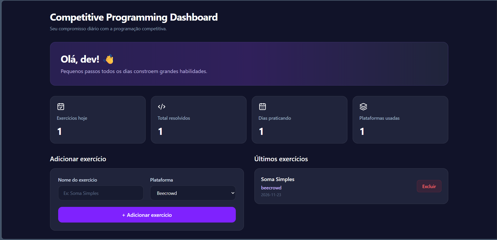

# 💻 CP Dashboard

**Seu compromisso diário com a programação competitiva.**

O CP Dashboard é uma aplicação web desenvolvida para acompanhar e incentivar a prática diária de programação competitiva (*Competitive Programming*).

A proposta é simples: registrar os exercícios resolvidos, acompanhar a evolução e criar o hábito de resolver pelo menos um problema todos os dias.

## 📸 Preview



## 🎯 Objetivo

O objetivo do projeto é ajudar programadores a manterem a consistência nos estudos de programação competitiva, oferecendo uma maneira simples de:

- Registrar os exercícios resolvidos diariamente.
- Acompanhar a quantidade de problemas solucionados.
- Visualizar o histórico de exercícios.
- Monitorar a frequência de prática.
- Manter a motivação para continuar evoluindo.

## ✨ Funcionalidades

- **Contador diário:** acompanha automaticamente quantos exercícios foram resolvidos no dia.
- **Total de exercícios:** contabiliza todos os problemas registrados.
- **Dias praticando:** mostra em quantos dias diferentes houve resolução de exercícios.
- **Plataformas utilizadas:** contabiliza as diferentes plataformas em que os exercícios foram resolvidos.
- **Registro de exercícios:** permite adicionar exercícios informando seu nome e plataforma.
- **Histórico de exercícios:** apresenta os exercícios registrados e permite excluí-los.
- **Persistência de dados:** utiliza LocalStorage para manter os registros mesmo após fechar ou atualizar a página.

## 🛠️ Tecnologias utilizadas

- **Vite** — ambiente de desenvolvimento e build.
- **React** — construção da interface e gerenciamento de estado.
- **JavaScript** — lógica e manipulação dos dados.
- **Tailwind CSS** — estilização e responsividade.
- **Lucide React** — biblioteca de ícones.
- **LocalStorage** — armazenamento local dos exercícios.

## 📸 Interface

O CP Dashboard possui uma interface moderna em tema escuro, com uma identidade visual baseada em tons de roxo e azul.

A organização da aplicação prioriza a visualização rápida das estatísticas, o registro de novos exercícios e o acompanhamento do histórico.

## 🚀 Como executar o projeto

### Pré-requisitos

- Node.js instalado.
- npm instalado.

### Instalação

Clone o repositório:

```bash
git clone https://github.com/SEU-USUARIO/cp-dashboard.git
```

Entre na pasta do projeto:

```bash
cd cp-dashboard
```

Instale as dependências:

```bash
npm install
```

Execute o servidor de desenvolvimento:

```bash
npm run dev
```

Acesse o endereço disponibilizado pelo Vite no terminal.

## 📚 Aprendizados

Este projeto também faz parte da minha jornada de aprendizado em desenvolvimento web, permitindo praticar conceitos como:

- Componentização com React.
- Props e comunicação entre componentes.
- Gerenciamento de estado com `useState`.
- Efeitos com `useEffect`.
- Manipulação de arrays com `map()` e `filter()`.
- Utilização de `Set` para trabalhar com valores únicos.
- Persistência de dados com LocalStorage.
- Estilização e criação de layouts responsivos com Tailwind CSS.

## 🔮 Próximos passos

O projeto poderá receber novas funcionalidades futuramente, como:

- Gráficos de evolução.
- Calendário de atividades.
- Sequência de dias consecutivos (*streak*).
- Metas pessoais de resolução de exercícios.
- Integração com plataformas de programação competitiva.

## 👨‍💻 Autor

Desenvolvido como projeto pessoal de aprendizado e como ferramenta para manter a consistência na prática de programação competitiva.

**Um exercício por dia. Evolução todos os dias.**